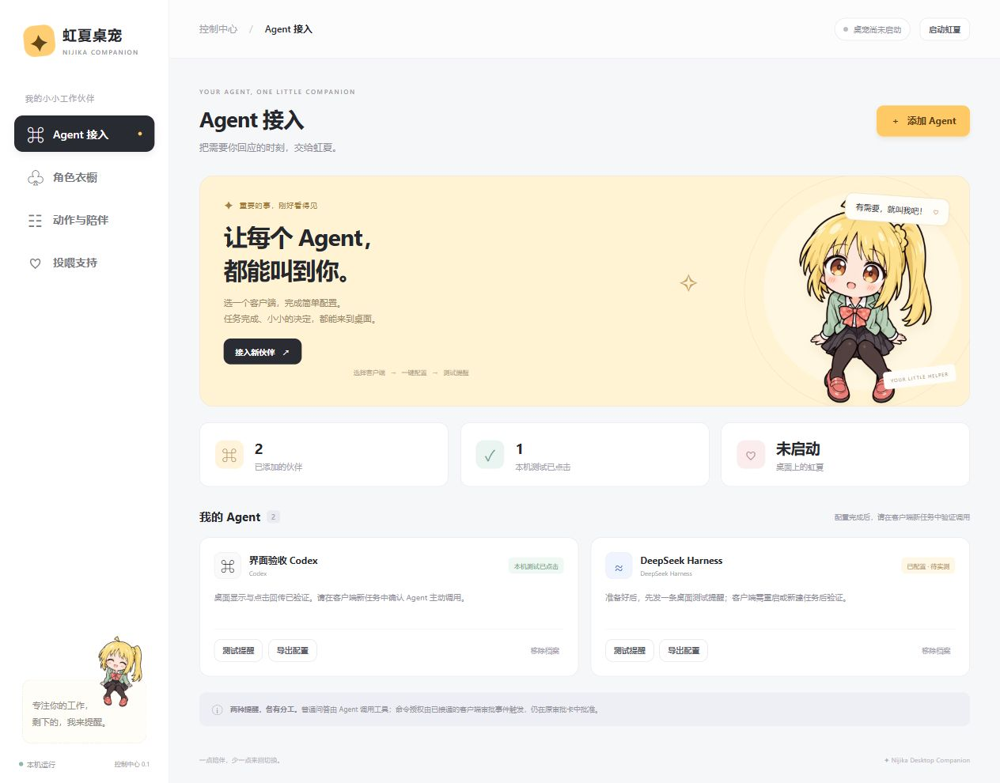

# 虹夏桌宠 · 2D 坐姿版

2026-10-15 新增独立控制中心：双击 `dist/虹夏控制中心.exe`，或右键桌宠选择“控制中心 / 添加 Agent”。首页用向导接入 Codex、ChatGPT 本机 Work、DSH；自动填写常用路径，先预览、再备份写入，并提供桌面测试与 MCP 配置导出。其余页面管理角色皮肤、动作/大小/表情/闲聊和可配置的投喂入口。没有新时装素材时可以导入透明 PNG 或九帧图片包；投喂未配置时不会展示虚构收款码。

控制中心需要 Windows 上可用的 Microsoft Edge WebView2；仅打开本机管理服务，不开放局域网或公网。桌宠和 MCP 的通知链路继续使用原队列。面板里的“测试已点击”只证明本机气泡和回执可用，客户端是否主动调用仍须在新任务中验证。设置保存后由新版桌宠应用，退出管理窗口不会退出桌宠。

2026-10-11 提醒可靠性更新：统一桌面快捷方式与客户端启动程序的消息库，兼容旧会话的点击回传，独立轮询并恢复隐藏或位置错误的气泡。普通提醒现场点击已通过；本机两项 Codex hook 完成信任后，真实 Codex CLI 审批已自动触发虹夏提醒并保存“知道了”回执。安装到其他电脑仍需本人在 `/hooks` 审阅并信任，授权仍在 Codex 审批卡完成。步骤和验收边界见 [AGENT_SETUP.md](AGENT_SETUP.md)。

桌面决策现在可为一个有明确理由的选项显示“推荐”。Agent 收到桌面点击后，应在原 Codex/Work 聊天中写明所选项，再按选择继续。这条聊天记录是 Agent 的确认消息，不会伪装成用户发送的新消息。如果 Agent 已结束等待，桌宠不会独立唤醒该任务，需要继续该聊天才能读取已保存的点击结果。

更新触发：2026-10-07 用户要求简单决策直接在桌宠完成，不必总回到聊天。

Windows 桌面上的 Q 版坐姿虹夏：完整双腿、透明背景、八种表情、自然眨眼。默认“活泼明显”动态：连续的待机呼吸、轻摆与偶尔弹跳；单击换表情并弹起，双击连续回应；按住角色拖动时倾斜，松手自然回正。右键可以选表情、大小、动态强度、手动说话、演示提醒或退出。日常气泡偶尔出现。Codex 可经本机 MCP 工具发送真实的完成提醒和选择题；简单选择及短成果审阅在气泡中显示完整决策信息和逐项简介，点击结果由当前 Agent 读取并继续任务，无需再回聊天确认。只有完整内容不适合气泡时，才使用单按钮完成提醒。菜单里的“演示”仍只在本地生效。

本机成品可双击 `dist/虹夏桌宠.exe` 启动；`dist/虹夏MCP-v2.exe` 是 Codex 自动启动的 stdio 服务，不需手动双击。当前电脑已注册 `nijika-pet` MCP 并安装 `skills/nijika-desktop-dialog/` 的全局副本；项目 `AGENTS.md` 规定何时主动发送提醒。独立 Codex CLI 会话已在普通审阅和选择任务中自主调用桌宠；Codex 桌面应用的新任务也已自动发出完成提醒并在桌面显示。Git 仓库只保存源码、素材、测试和文档，`dist/` 生成文件不入库；克隆后按 `INSTALL.md` 构建和注册。动画预览见 `art/motion-preview.gif`，气泡外观见 `art/bubble-preview.png`，角色帧在 `assets/sprites/`。

对外分享文档可运行 `.\.venv\Scripts\python.exe tools\package_docs.py` 从当前源码生成压缩包；旧压缩包不作为最新工程状态的依据。

给熟人私下试用可运行 `.\.venv\Scripts\python.exe tools\package_release.py` 生成 Windows 安装 ZIP；收件人按包内 `distribution/README.md` 安装。该包包含可执行程序和可选的 Codex、Work、DSH 接入文件，不包含个人消息库。公开发布的素材权利仍需另行确认。

**Agent 接入配置集中见 [AGENT_SETUP.md](AGENT_SETUP.md)**：分别说明私下试用包、Codex、桌面客户端 Work、DSH，以及其他支持 stdio MCP 的本机客户端如何配置和验证。

桌面客户端 Work 的本机接入包在 `plugins/nijika-work-local/`，本机已通过 `.agents/plugins/marketplace.json` 安装并启用。它把同一 `虹夏MCP-v2.exe` 作为插件工具提供，并附带 Work 对话用的简短决策 skill。独立 Codex 会话关闭原有直连后仍通过插件实际调用成功；这证明插件工具链可用，但不等于 Work 会话已经连接。首次使用需重启桌面客户端、在**本机运行的 Work 新任务**中确认工具可见并完成一次桌面点击回传。云端 Work 对话不能直接运行这个 Windows 本机 stdio 程序；那种接入需要另行设计可安全访问的远程 MCP 服务。详见 `INSTALL.md`。

Codex 全局技能和本机 Work 插件 0.1.5 均已加入“同一请求连续等待、恢复会话先读旧回复”的规则。较晚的点击会保存，但一旦 Agent 任务结束，现有 stdio MCP 无法单靠桌面点击重新唤醒任务；在原会话发送“继续”可触发读取。当前打开的会话不保证热更新，新的 Work 插件还需重启 ChatGPT 桌面客户端后在新任务中验收。

DSH 本机接入脚本在 `integrations/dsh/install.ps1`，默认注册 desktop 和 web 两个配置，安装专用技能及全局触发规则。本机已写入配置并通过 DSH web 合成配置检查、打包 MCP 握手及隔离选择回传测试。DSH 新会话已自主调用虹夏并显示带 DSH 来源的气泡；用户较晚点击后，回复保存在消息库，但 DSH 原任务已结束，未自动读回。技能现要求重复等待并在会话恢复时读取旧请求；无时限自动唤醒尚未实现。操作和限制见 `integrations/dsh/README.md`。

运行环境为 Windows 10/11 x64；源码使用 Python 3.12、Pillow 12.2、官方 MCP Python SDK 2.3，打包使用 PyInstaller 6.20。本机消息保存在用户目录的 SQLite 文件；已处理消息 7 天后清理，未处理消息 30 天后过期。MCP 只走本机 stdio，不开放网络端口。需求与验收见 `REQUIREMENTS.md`，待办见 `TODO.md`，架构与内部接口分别见 `ARCHITECTURE.md` 和 `INTERFACES.md`。这是非官方同人练习；仓库没有声明可供第三方复用角色素材的许可证。
